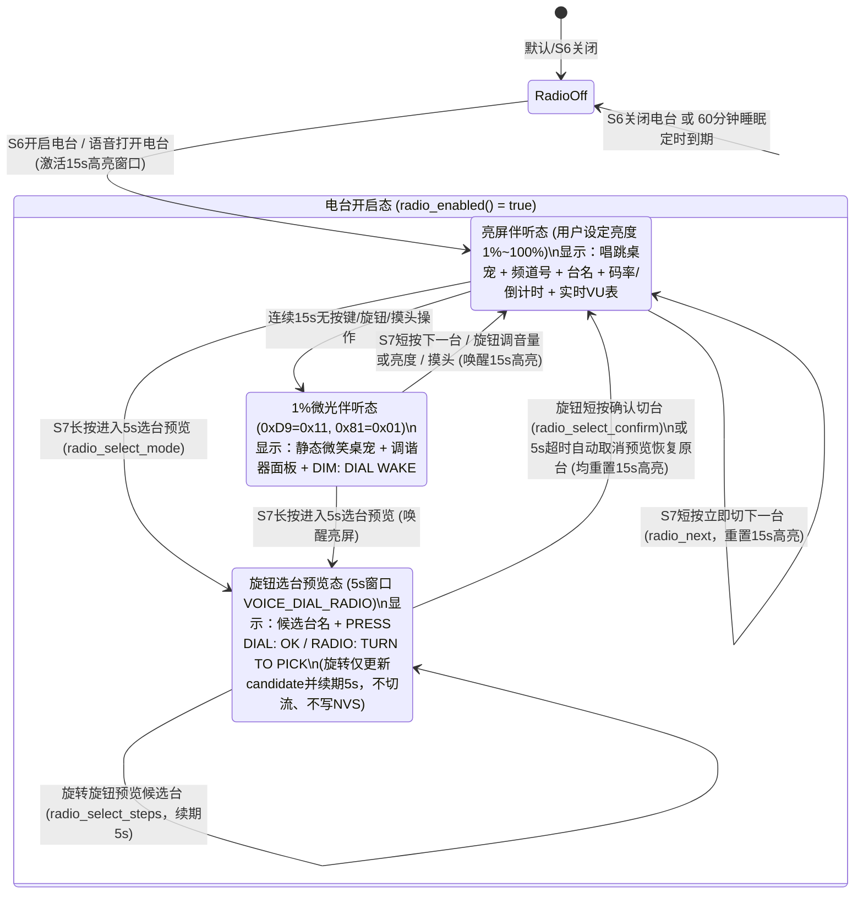

# EasyInput-V2 电台播放 OLED 伴听屏设计文档（Auto-Dim Now Playing + Live VU Meter）

## 1. 背景与设计目标

当前 EasyInput-V2 在开启 S6 网络电台播放后，仅在“S7 长按进入的 5 秒旋钮选台预览窗口（`VOICE_DIAL_RADIO`）”期间点亮屏幕显示候选台名，其余播放时间 [`oled_task()`](../../esp32/main/easyinput_oled.c) 会因为 `dark == true` 直接下发 `0xAE` 关闭 OLED 面板。这导致白天或桌面收听时设备显得像死机/断电，无法获知当前频道、码率、定时睡眠剩余时间或播放状态。

本设计在不改变现有已验收按键/旋钮选台与 NVS 记忆逻辑的前提下，将**方案 A（两段式智能微光伴听）**与**方案 B（Hi-Fi 数字调谐器 + 实时 PCM 音频电平跳动表）**融合，实现以下核心目标：
1. **全时段优雅可视**：白天桌面有精致的数字调谐器动态律动，夜间床头伴睡在 15 秒无操作后自动降至 **1% 硬件级超微光**（`0xD9=0x11, 0x81=0x01`），绝不刺眼。
2. **严守已验收选台与记忆契约**：完全保留“S7 短按下一台、S7 长按进入 5 秒旋钮预览、旋转仅预览候选台、旋钮短按确认切台、5 秒超时取消预览”的既有交互与 NVS 2 秒防抖记忆规则。
3. **零烧屏风险 & 零额外内存分配 & 严守 15 字符行宽预算**：动态音频电平条（VU Meter）与桌宠唱跳动画在亮屏期保持像素流动；微光伴听期以 1% 极限微光静态低频运行；右侧文本区严格控制在 `<= 15` 字符。

---

## 2. 方案架构与状态流转



> **按键与旋钮职责说明（保持既有行为不变）**：
> - **S6 短按**：开启 / 关闭电台（`radio_toggle()`）。
> - **S7 短按**：立即切换到下一台（`radio_next()`），触发 2 秒防抖 NVS 保存。
> - **S7 长按**：进入 **5 秒**旋钮选台预览模式（`radio_select_mode()`，`VOICE_DIAL_RADIO`）。在此期间：
>   - **旋转旋钮**：仅切换预览候选台 `s.candidate` 并播报 8kHz 本地中文台名、续期 5 秒窗口，**不中断当前播放流、不写 NVS**。
>   - **短按旋钮**：确认切换到候选台（`radio_select_confirm()`），触发流切换与 NVS 保存。
>   - **5 秒无操作超时**：自动取消预览，恢复显示原播放电台。

---

## 3. 详细设计

### 3.1 方案 A：两段式智能微光控制（Auto-Dimming）

- **移除电台强制黑屏（`0xAE`）**：
  在 [`esp32/main/easyinput_oled.c`](../../esp32/main/easyinput_oled.c) 的 [`oled_task()`](../../esp32/main/easyinput_oled.c) 中，不再因电台播放（`dark == true`）发送 `0xAE` 关屏命令，而是保持面板开启（`0xAF`），将电台无操作超时的视觉降级交由硬件 1% 微光机制处理。
- **15 秒活跃高亮窗口（`RADIO_ACTIVE_BRIGHT_US = 15 * 1000000LL`）**：
  - 在 [`render()`](../../esp32/main/easyinput_oled.c) 中维护电台活跃时间戳：
    - 当发生摸头/旋钮旋转（`easyinput_oled_headpat()` 更新 `s_headpat_until`）、旋钮处于亮度或选台模式（`dial != VOICE_DIAL_VOLUME`）、或电台刚刚启动/切换频道/处于缓冲态（`radio_station()` 变化）时，刷新 `s_last_active_time = now`。
    - 当电台正在稳定播放（`radio >= 0 && radio < 100`）且距离最近一次交互已超过 **15 秒**（`now - s_last_active_time > 15000000LL`），置位电台微光标志 `radio_dim = true`。
- **复用 1% 硬件微光通路**：
  - [`oled_task()`](../../esp32/main/easyinput_oled.c) 中现有的 `s_is_sleeping` 硬件降级逻辑（`level = 1`, `period = easyinput_oled_precharge(1)` -> `0xD9=0x11, 0x81=0x01`）直接扩展为 `bool low_glow = s_is_sleeping || s_radio_dim;`，零新增寄存器命令路径，也不修改用户保存在 `easyinput_board` 中的亮度配置值。

---

### 3.2 方案 B：Hi-Fi 数字调谐器面板与实时 VU 电平表

#### 3.2.1 128×64 像素与字符布局（严守右侧 15 字符上限）

OLED 分辨率为 `128×64`（共 8 Pages，每 Page 高 8px）。前 4 行（`Page 0..3`）左侧 `x=0..31` 为 `32×32` 机器人表情，右侧从 `x=36` 开始可用宽度为 `92px`，使用 `6×8` 字体最多容纳 **15 个 ASCII 字符**（`15 * 6 = 90px <= 92px`）：

| 行号 (Page) | 区域与坐标 | 播放稳态 (`PLAYING` 15s亮屏期) | 播放稳态 (`PLAYING` 1%微光期) | 选台预览态 (`VOICE_DIAL_RADIO` 5s) | 缓冲/重连态 (`LOADING`) | 字符数校验 |
| :--- | :--- | :--- | :--- | :--- | :--- | :--- |
| **Left 32×32** (`Page 0..3`) | `x=0..31, y=0..31` | `s_robot_speak` / `s_robot_speak_closed` 随音乐张合跟唱 | `s_robot_idle` 静态微笑伴听 | `s_robot_listen` 竖耳倾听选台 | `s_robot_idle` / `s_robot_listen` | 32×32 位图 |
| **Page 0** (Row 0) | `x=36..125` | `TinyPal CH07/12` | `TinyPal CH07/12` | `TinyPal CH07/12` | `TinyPal CH07/12` | `15` chars |
| **Page 1** (Row 1) | `x=36..125` | `ON AIR 128k 58m` | `ON AIR 128k 58m` | `PICK STATION` | `RADIO: LOADING` | `<= 15` chars |
| **Page 2** (Row 2) | `x=36..125` | `FM: SG KISS 92` | `FM: SG KISS 92` | `FM: SG KISS 92` | `FM: SG KISS 92` | `<= 15` chars |
| **Page 3** (Row 3) | `x=36..125` | `VU \|\|\|\|\|\|\|...` | `DIM: DIAL WAKE` | `PRESS DIAL: OK` (静音时 `MUTED: DIAL OK`) | `S6 TO STOP` | `10..14` chars |
| **Page 4** (Row 4) | `x=0..127` | 顶部微细虚线分割线 (`y=32`) | 同左 | 同左 | 同左 | 图形绘制 |
| **Page 5** (Row 5) | `x=0..127` | `>VOL  65%  BRI  20%` | `>VOL  65%  BRI  20%` | ` VOL  65%  BRI  20%` | `>VOL  65%  BRI  20%` | `19` chars |
| **Page 6** (Row 6) | `x=0..127` | `BAT ~82% 3.98V` | 同左 | 同左 | 同左 | `<= 21` chars |
| **Page 7** (Row 7) | `x=0..127` | `S6 STOP  S7 NEXT/SEL` | `S6 STOP  S7 NEXT/SEL` | `RADIO: TURN TO PICK` | `S6 STOP  S7 NEXT/SEL` | `20` chars |

- **Page 0 (`TinyPal CH07/12`)**：当处于电台播放或选台预览时，首行右侧追加当前（或候选）频道序号 `CH01/12`..`CH12/12`（共 15 字符）；非电台模式时保持原有的 `"TinyPal"`。
- **Page 1 (`ON AIR 128k 58m`)**：
  - 播放稳态时，替代原本固定不变的 `"NET: READY"`，动态展示流媒体码率（如 `128k` / `64k`，未知时显示 `LIVE`）与 60 分钟自动休眠剩余分钟数（如 `58m`），格式如 `"ON AIR 128k 58m"`（15 字符）。
  - 选台预览态时显示 `"PICK STATION"`（12 字符），缓冲态时显示 `"RADIO: LOADING"`（14 字符）。
- **Page 2 (`FM: SG KISS 92`)**：保持与现有代码一致，在 Page 2 显示 `radio_station_label()`，无需改变用户视线习惯。
- **Page 3 (`VU |||||||...` / `PRESS DIAL: OK` / `DIM: DIAL WAKE`)**：
  - **5 秒选台预览态**：严格保留现有的 `muted ? "MUTED: DIAL OK" : "PRESS DIAL: OK"`。
  - **15 秒亮屏播放态**：显示 10 格实时音频包络电平条 `'VU '` + 10 格 `'|'` 或 `'.'`（共 13 字符，如 `"VU ||||||...."`）。
  - **1% 微光伴听态**：固定显示 `"DIM: DIAL WAKE"`（14 字符），提示拨动旋钮即可唤醒亮屏。
- **Page 7 (`S6 STOP  S7 NEXT/SEL`)**：明确提示 S7 兼具短按下一台（`NEXT`）与长按选台（`SEL`）职责（20 字符，适配全屏宽 21 字符上限）；选台预览态保持现有的 `"RADIO: TURN TO PICK"`。

---

### 3.3 实时音频电平（VU Meter）与电台遥测接口设计

#### 3.3.1 `radio.h` / `radio.c` 新增轻量级只读遥测快照

在 [`esp32/main/radio.h`](../../esp32/main/radio.h) 中定义无锁只读状态结构体与查询函数：

```c
typedef struct {
    bool active;               // 电台开启或选台预览中
    bool playing;              // 已解码出声音正在输出
    bool selecting;            // 处于5秒S7长按选台预览窗口
    uint8_t station_index;     // 当前显示台号 0..11 (选台时为candidate，否则为station)
    uint8_t station_count;     // 12
    uint16_t bitrate_kbps;     // MP3流码率，如 128, 64
    uint8_t remain_min;        // 距离60分钟自动休眠的剩余分钟数 1..60
    uint8_t vu_level;          // 实时PCM音频峰值电平 0..10
} radio_telemetry_t;

void radio_get_telemetry(radio_telemetry_t *out);
```

#### 3.3.2 零开销 PCM 峰值包络计算（在 `radio.c:output()` 内完成）

在 [`output(audio_t *audio, size_t count, float gain, bool prompts)`](../../esp32/main/radio.c) 完成混音与音量缩放后，顺带统计当前 192 帧（`4 ms`）输出样本的最大绝对振幅（步进抽样 `i += 4`，每次仅 48 次整数比较，CPU 耗时 `< 1 µs`）：
1. 取 16-bit 归一化峰值 `peak = max(abs(sample >> 16))`（`0..32767`）。
2. 映射为 `0..10` 档电平（`level = min(10, (peak + 1400) / 1800)`）。
3. **快攻慢衰平滑（Fast Attack, Slow Decay）**：
   - 若 `level >= s_vu_level`，立即跃升：`s_vu_level = level`；
   - 若 `level < s_vu_level`，每约 `40 ms` 衰减 1 格，使 OLED 上的 `||||||....` 具有专业 Hi-Fi 功放表头的自然回落弹性。
4. 当流停止或处于 `LOADING` 缓冲期时，`s_vu_level` 自动归零。

#### 3.3.3 I2C 刷新频率与功耗控制

- **亮屏期（15 秒活跃窗口或 5 秒选台窗口内）**：[`oled_task()`](../../esp32/main/easyinput_oled.c) 将轮询间隔从 `500 ms` 缩短至 `150 ms`（约 6.7 FPS），使 VU 电平条和桌宠跟唱嘴型自然律动。
- **1% 微光伴听期（15 秒无操作后）或普通待机期**：
  - 恢复 `500 ms` 轮询，且因桌宠固定为 `s_robot_idle`、第 4 行固定为 `"DIM: DIAL WAKE"`，`frames` 与 `frames + 1024` 的 `memcmp` 比较在整分钟内完全相同，**每 60 秒仅当 `remain_min` 减 1 时才产生一次 I2C 刷屏**，平时 I2C 总线零通信、零射频干扰。

---

## 4. 涉及文件与改动范围

1. **[`esp32/main/radio.h`](../../esp32/main/radio.h) & [`esp32/main/radio.c`](../../esp32/main/radio.c)**：
   - 新增 `radio_telemetry_t` 与 `radio_get_telemetry()`。
   - 在 `play()` 解码首帧时记录 `info.bitrate_kbps`，在 `output()` 中更新 `s_vu_level`，在 `radio_get_telemetry()` 中根据 `s.deadline` 计算 `remain_min`。
2. **[`esp32/main/easyinput_oled.c`](../../esp32/main/easyinput_oled.c)**：
   - 新增 `s_radio_dim`（电台播放满 15 秒无操作时置位），与 `s_is_sleeping` 共同驱动 1% 硬件微光。
   - 在 `oled_task()` 中移除 `dark` 关屏（`0xAE`）分支，改为常显 + 自动 1% 微光；活跃亮屏期采用 `150 ms` 刷新周期以呈现动态 VU 表，微光期恢复 `500 ms` 静态缓存防刷屏。
   - 在 `render()` 中接入 `radio_get_telemetry()`，渲染 `TinyPal CHxx/12`、`ON AIR xxxk xxm`、`VU ||||||....` / `DIM: DIAL WAKE` 及 `S6 STOP  S7 NEXT/SEL`。
3. **[`esp32/tests/test_oled_text.py`](../../esp32/tests/test_oled_text.py) & [`esp32/tests/test_radio_lifecycle.py`](../../esp32/tests/test_radio_lifecycle.py)**：
   - 新增对调谐器面板所有文本行长度（右侧 `<= 15` 字符、底栏 `<= 21` 字符）、5 秒选台预览契约保持不变、15 秒自动微光状态机以及 `radio_get_telemetry()` 的单元测试。
